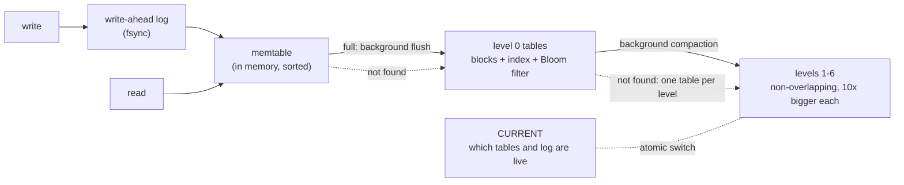
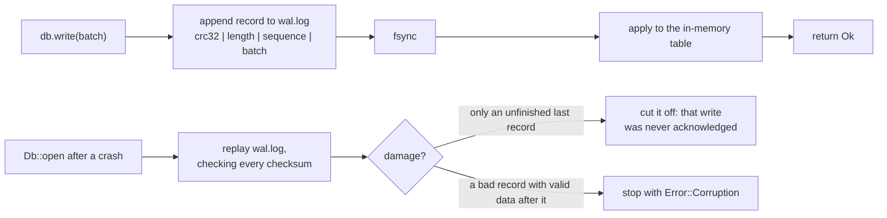

# StrataKV

A crash-safe key-value storage engine in Rust, built as a log-structured merge tree (LSM tree): the
design behind LevelDB, RocksDB and Cassandra's storage.

**The promise: once a write returns `Ok`, it survives a crash.** Every claim below is backed by a test
you can run with `cargo test`.

| Phase | What | Status |
|---|---|---|
| 1 | Write-ahead log, in-memory table, crash recovery, kill -9 crash test | **done** |
| 2 | Sorted files on disk (SSTables), Bloom filters, block index, atomic `CURRENT` switch | **done** |
| 3 | Levels and background compaction: old versions and deletes stop using disk; atomic install | **done** |
| 4 | Range scans and consistent snapshots (MVCC): every version kept until no snapshot can see it | **done** |
| 5 | Benchmarks against RocksDB and SQLite; background flushes, lazy scans, a process-safe LOCK | **done** |
| 6 | Figures, docs, polish | |

## Use it

```rust
use stratakv::{Db, Options, WriteBatch};

let db = Db::open("my-db", Options::default())?;      // fsync before every write returns (the default)
db.put("user:1", "Ada")?;
assert_eq!(db.get(b"user:1")?.as_deref(), Some(&b"Ada"[..]));

let mut batch = WriteBatch::new();                     // all or nothing, even across a crash
batch.put("account:a", "90").put("account:b", "110");
db.write(&batch)?;
db.delete("user:1")?;

for item in db.scan_prefix("account:")? {             // in key order; also db.scan("a".."m")
    let (key, value) = item?;
}
let snap = db.snapshot();                              // a frozen view: later writes are invisible to it
assert_eq!(snap.get(b"account:a")?.as_deref(), Some(&b"90"[..]));
```

## How fast is it?

1,000,000 keys (16-byte keys, 100-byte values), one client thread, a 4-core cloud VM, median of 3 runs.
RocksDB is given the same tree shape as StrataKV. Full method, latency and space numbers: [docs/phase-5.md](docs/phase-5.md).

| Operations per second | StrataKV | RocksDB 11.8 | SQLite 3 (WAL) |
|---|---:|---:|---:|
| Random writes | 381 K | 386 K | 20 K |
| Random reads | 238 K | 153 K | 199 K |
| Reads of missing keys | 1.02 M | 578 K | 201 K |
| Scans of 100 keys | 26 K | 23 K | 45 K |
| Bulk load (batches of 1,000) | 752 K | 1.91 M | 480 K |
| Write amplification, random writes | 6.0x | 5.1x | 115x |

The whole database fits in RAM here, so these numbers measure CPU and system-call costs rather than the disk.
StrataKV is level with RocksDB on random writes and ahead on point reads in this setting, is 2.5x slower at bulk
loading, and SQLite's B-tree is best at scans. `bench/run.sh` reproduces it.

## How it fits together



## How a write stays safe (Phase 1)



## What the tests prove

| Claim | Test |
|---|---|
| No acknowledged write is lost when the process is killed (`SIGKILL` at random moments, 60 rounds by default, same database every round) | `tests/crash.rs` |
| A batch is never half applied, including its deletes | `tests/crash.rs`, `tests/db.rs` |
| Cutting the log at **any** byte recovers exactly the batches that were whole | `tests/db.rs` (property test), `src/wal.rs` |
| A flipped bit anywhere before the last record is reported as corruption, never skipped | `src/wal.rs` |
| An unfinished write at the end (partial record, zero-filled tail) is removed from the file before new writes | `src/wal.rs`, `tests/db.rs` |
| After a failed disk write, the failed write is not readable and later writes are refused until reopen | `src/db.rs` |
| Random writes, deletes, batches and reopenings always match a plain in-memory map | `tests/db.rs` (property test) |
| Only one process can open a database | `tests/db.rs` |
| A crash at **each step** of a flush to disk loses nothing and leaves no leftover files | `tests/crash.rs` |
| Any flipped byte in a table file is caught, never a wrong answer | `src/sstable.rs` |
| A delete in a newer table hides older values, before and after reopening | `tests/flush.rs` |
| Lookups for missing keys read about 1% of the blocks they would without Bloom filters (measured: 1,120 instead of 140,000) | `tests/flush.rs` |
| A crash at **each step** of a compaction loses nothing and leaves no leftover files (compaction on its background thread) | `tests/crash.rs` |
| Overwritten data stops using disk: 1.94 MB of overwrites leave 23–38 KB of tables (21 KB live) | `tests/compaction.rs` |
| Deleting everything and compacting leaves 0 bytes; a delete is never dropped while an older value exists below | `tests/compaction.rs` |
| Deeper levels never overlap; a lookup reads at most one block per level (measured: 0.63 per lookup) | `tests/compaction.rs` |
| Any mix of writes, deletes, flushes, compactions and reopenings on a tiny tree reads like a plain map | `tests/compaction.rs` (property test) |
| Every open snapshot reads exactly like a copy of a plain map taken when it was opened, through flushes and compactions | `tests/snapshots.rs` (property test) |
| Under 4 concurrent writers moving money in batches, every snapshot and scan sees a consistent total | `tests/snapshots.rs` |
| Old versions are kept while a snapshot can see them and reclaimed once it is dropped (13 MB → 26 MB → 13 MB) | `tests/snapshots.rs` |
| Tables written by Phases 2–3 still read after the format change | `src/sstable.rs` |
| A scan reads the memtable lazily and stays consistent while background flushes and compactions replace it | `src/memtable.rs`, `tests/snapshots.rs` |
| Reopening never fails because another thread is starting a process (it did for 10,571 of 20,000 reopens with `flock`) | `tests/db.rs` |
| Another process cannot open an open database, and a refused open in the same process does not release the lock | `tests/db.rs` |

The crash test kills a real process, so it proves safety against **process crashes**. Data that was
written but never reached the disk before a **power cut** is modelled by the torn-write tests (cut the
log at every byte, zero-filled tails); testing on real power loss would need a tool such as LazyFS.

```bash
cargo test                                   # everything (the crash test takes ~30 s)
STRATAKV_CRASH_ROUNDS=500 cargo test --test crash -- --nocapture
```

More: [docs/phase-1.md](docs/phase-1.md) (the log and recovery), [docs/phase-2.md](docs/phase-2.md) (tables, Bloom filters, the flush protocol), [docs/phase-3.md](docs/phase-3.md) (levels and compaction), [docs/phase-4.md](docs/phase-4.md) (scans and snapshots), [docs/phase-5.md](docs/phase-5.md) (benchmarks).
