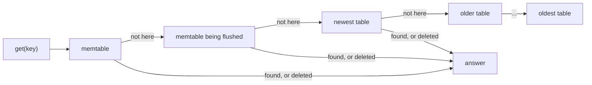

# Phase 2: sorted tables on disk

## The idea in plain words

In Phase 1 everything lived in memory and the log grew forever. Now, when the in-memory table reaches
4 MiB, StrataKV writes it to disk as a **sorted table** (an SSTable), starts a fresh log, and deletes the
old one. The database can now hold far more data than fits in memory, and restarts stay fast.

A read looks at the newest data first and stops at the first layer that knows the key:



A delete is stored as a **tombstone**. A tombstone in a newer layer hides any older value of that key, so
a deleted key never "comes back" from an older table.

## Inside a table

```text
| data block | data block | ... | index | Bloom filter | footer (60 bytes) |
```

- **Data blocks** (about 4 KiB) hold sorted keys and values. Each has a CRC32 checksum.
- **The index** lists each block's last key, position and checksum. A lookup binary-searches it and
  reads exactly **one** block.
- **The Bloom filter** is a small bit array that answers "definitely not here" for most missing keys, so
  most lookups for a key a table does not hold read nothing from that table.
- **The footer** locates the index and filter, has their checksums, is checksummed itself, and ends with
  a magic number. A table is checked against its exact size when the database opens.

Measured in `tests/flush.rs`: 20,000 lookups for missing keys across 7 tables read **1,120** blocks
instead of 140,000 (0.8%, as expected for 10 bits per key). A key that exists costs one block read.

## Switching to a new table safely

The small `CURRENT` file lists the live tables (with their sizes) and the oldest log still needed.
A flush happens in four steps:

| Step | What happens | If the process crashes right after it |
|---|---|---|
| 1 | fsync the current log; start a new log for new writes | old `CURRENT` still names the old log: it is replayed, nothing lost |
| 2 | write the table as `NNNNNN.sst.tmp`, fsync, rename, fsync the directory | the table is not in `CURRENT`, so it is a leftover: deleted on open, the old log is replayed |
| 3 | write `CURRENT.tmp`, fsync, rename over `CURRENT`, fsync the directory (atomic) | the new state is in effect: the table is used and the old log is ignored |
| 4 | delete the old log | nothing to do |

Every one of these moments is tested: the crash-test writer aborts itself at exactly that step (both sync
modes), and the test checks that every acknowledged write is there, no leftover files remain, and the
database keeps working.

## What the tests prove

| Claim | Test |
|---|---|
| A crash at **each step** of a flush loses nothing and leaves no leftovers | `tests/crash.rs` (`a_crash_at_every_step_of_a_flush_loses_nothing`) |
| Random kills during heavy writing with frequent flushes lose nothing | `tests/crash.rs` (random kills; some land mid-flush) |
| Any mix of writes, deletes, batches, flushes and reopenings with a tiny memtable reads like a plain map | `tests/flush.rs` (property test) |
| A delete in a newer table hides older tables, before and after reopening | `tests/flush.rs` |
| Any flipped byte in a table is caught (at open or when its block is read), never a wrong answer | `src/sstable.rs` |
| A table cut short, missing, or a damaged `CURRENT` stops the open | `tests/flush.rs`, `src/version.rs` |
| Bloom filters: about 1% false positives; missing-key lookups read about 1% of the blocks | `src/bloom.rs`, `tests/flush.rs` |

## Known limits (Phase 3 fixes them)

- Tables are never merged, so reads get slower as tables pile up (the filters keep missing-key lookups
  cheap, but a found key still checks newer tables first), and old versions and tombstones use disk space
  forever. **Compaction** merges tables and drops what is hidden.
- A flush runs inside the write that fills the memtable, so that one write waits for it. Background
  flushing comes with the benchmarks in Phase 5.
