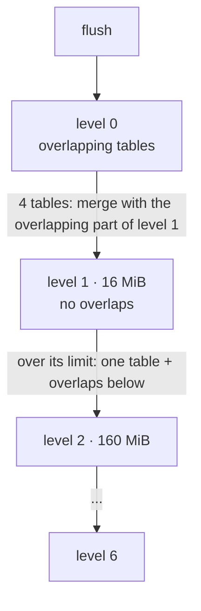

# Phase 3: compaction

## The problem it solves

After Phase 2, every flush added another table and nothing ever went away. Overwriting a key 100 times
left 100 copies on disk, deleted keys kept their old values and their tombstones forever, and reads might
check more and more tables.

## The idea in plain words

Tables are kept in **levels**:

| Level | What it holds | A read checks |
|---|---|---|
| 0 | tables straight from flushes; their key ranges overlap | each one, newest first |
| 1 | tables whose key ranges do **not** overlap, sorted by key; up to 16 MiB | at most one (binary search on ranges) |
| 2..6 | the same, each level 10 times bigger than the one above | at most one per level |

When level 0 has 4 tables, or a level is over its size limit, a background thread **compacts**: it merges
the chosen tables with the overlapping tables one level down and writes new tables there. The merge:

- keeps only the **newest** version of each key (older copies are dropped);
- drops a **delete** (tombstone) once no older version of that key can exist in any deeper level. Until
  then the tombstone must stay, or the old value would come back. (`a_tombstone_is_kept_while_an_older_value_exists_below`)
- streams: one block per input table in memory at a time, so tables of any size can be merged;
- splits its output into tables of about 2 MiB, so later compactions stay small.

A table whose range overlaps nothing below it is simply relabelled with the next level (a *trivial move*):
nothing is rewritten. `compact_all()` merges everything into one sorted run and drops every tombstone.

## Crash safety

A compaction changes the database the same way a flush does: write the new tables (temporary file, fsync,
rename), then replace `CURRENT` atomically (inputs out, outputs in), then delete the inputs. A crash before
the switch leaves the new tables as leftovers; a crash after it leaves the old ones. Either way the next
open deletes the leftovers, and nothing is lost or applied twice.

The crash test aborts the writer at each of the four compaction steps (and the six flush steps), in both
sync modes, with compaction running on its background thread.

When a compaction finds damage (a block failing its checksum), it stops and reports it in
`stats().compaction_error`; nothing is changed, writes continue, and the data that can be read stays
readable. `CURRENT` also checks on open that no two tables in a deeper level overlap.

## Measured (from `tests/compaction.rs`)

| Workload | Result |
|---|---|
| 200 keys overwritten 100 times (1.94 MB written) | 23–38 KB of tables left on disk (live data: 21 KB); compaction rewrote about 1.8–1.9x the data written |
| 5,000 keys written, all deleted, `compact_all()` | 0 tables, 0 bytes |
| 30,000 random writes and deletes over 20,000 keys | levels settle to about [0, 3, 36, 41] tables; 0.63 block reads per lookup |

The exact numbers vary a little between runs, because background compaction runs at different moments.

## Opening a Phase 2 database

`CURRENT` files written by Phase 2 have no levels; they still open, every table is treated as level 0,
and the first compactions move them down (`a_database_from_phase_two_opens_and_is_compacted`).

## Known limits

- One compaction at a time, on one background thread.
- No write slowdown: if writes outpace compaction, level 0 grows and reads slow down (Phase 5 measured level 0
  reaching 8 tables under 1,000,000 random writes).
- Deleted tables are removed while readers may still hold them open. That is safe on Linux and macOS
  (an open file outlives its name) but not on Windows.
- A compaction keeps only the newest version of each key. Phase 4 (snapshots) changed this: older versions
  are kept while a snapshot can still see them (see [phase-4.md](phase-4.md)).
