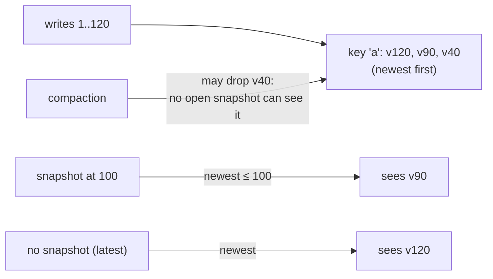

# Phase 4: range scans and snapshots

## The problem it solves

Before Phase 4 you could only ask for one key at a time, and only for its latest value. Two things real
programs need were missing:

- **Range scans:** "every key from `user:100` to `user:200`" or "every key starting with `order:`", in order.
- **Consistent reads:** reading many keys while other threads keep writing, without seeing half of a
  change (account A already debited, account B not yet credited).

## Use it

```rust
for item in db.scan("user:100".."user:200")? {          // also ..=, open ranges, (Bound, Bound)
    let (key, value) = item?;
}
let orders: Vec<_> = db.scan_prefix("order:")?.collect::<Result<_, _>>()?;

let snap = db.snapshot();                                // the database as it is right now
db.put("a", "changed")?;
assert_eq!(snap.get(b"a")?, old_value);                  // the snapshot still sees the old value
for item in snap.scan_prefix("account:")? { /* a consistent view, whatever writers do */ }
drop(snap);                                              // compaction may now reclaim the old versions
```

## The idea in plain words

Every write already had a **sequence number** (1, 2, 3, ...) from Phase 1. Phase 4 keeps it everywhere:

- The memtable and the tables now keep **every version** of a key, each stamped with its sequence number,
  ordered by key and then newest first. Before, a new value replaced the old one.
- A **snapshot is just a number**: the sequence number of the last write when it was taken. Reading
  through it means "for each key, the newest version with a number at or below mine". Taking one costs a
  lock and a counter; nothing is copied.
- A **scan** merges the memtable and every table that overlaps the range (a k-way merge with a heap, the
  same one compaction uses), skips versions that are too new, keeps the first remaining version of each
  key, and hides deletes. A plain `db.scan` takes an implicit snapshot when it starts, so writes made while
  you iterate never show up half way through.



## When compaction may drop a version

Phase 3 kept only the newest version of each key. Now an older version must stay as long as some open
snapshot could still read it. The rule (the same one LevelDB uses), with `oldest` = the smallest open
snapshot number (or "infinity" if none are open):

1. A version is dropped if a **newer version of the same key** has a number `≤ oldest`. Every snapshot sees
   that newer version (or something newer still), so nobody can see this one.
2. A delete (tombstone) is dropped if its number is `≤ oldest` **and** nothing older of that key can exist
   in a deeper level. Every snapshot sees the key as deleted, and nothing below would come back.

So a snapshot holds disk space until it is dropped, and not a moment longer
(`old_versions_are_reclaimed_once_the_last_snapshot_is_dropped`).

One more rule: compaction splits its output into ~2 MiB tables, but **never between two versions of the
same key**. A lookup in a deeper level checks only the one table whose range covers the key; if the versions
were split across two tables, a snapshot could find the wrong one
(`outputs_are_split_by_size_but_never_inside_one_key`).

## File format change

Each table entry, and each block-index entry, now carries its sequence number. New tables say `STRATAS2`
in their footer. Tables written by Phases 2 and 3 (`STRATASS`) still open and read normally, with every
entry treated as sequence 0, i.e. older than anything written since
(`format_one_tables_still_read_with_every_entry_at_sequence_zero`). Compaction rewrites them in the new
format over time.

## A bug the tests found

The first version of the retention code used `u64::MAX` to mean "no newer version of this key yet". With no
snapshot open, the oldest snapshot is *also* `u64::MAX`, so `newer ≤ oldest` was true for the **first**
version of every key: compaction would have deleted all data. The unit test
`without_snapshots_only_the_newest_version_survives` caught it before anything else ran; the code now uses
`Option<u64>` instead of a magic number.

## Tests (`tests/snapshots.rs`, plus unit tests)

| Claim | Test |
|---|---|
| Scans return the latest values in key order, for `..`, `a..b`, `a..=b`, `a..`, `..b` and excluded starts | `a_scan_returns_the_latest_values_in_key_order` |
| Scans read the same before and after flushes, compactions and `compact_all` | `scans_see_the_same_thing_in_memory_on_disk_and_after_compaction` |
| `scan_prefix` covers exactly its keys, including prefixes ending in `0xff` and the empty prefix | `scan_prefix_covers_exactly_the_keys_with_that_prefix` |
| A snapshot keeps reading the old values through overwrites, deletes, flushes and compactions | `a_snapshot_keeps_seeing_the_past_through_...` |
| A snapshot does not see keys written or deleted after it | `a_snapshot_does_not_see_keys_written_after_it` |
| Old versions use disk while a snapshot (or a clone of it) is open, and are reclaimed when the last one is dropped | `old_versions_are_reclaimed_once_the_last_snapshot_is_dropped` |
| A running scan is not changed by writes and compactions that happen while it runs | `a_scan_is_not_disturbed_by_writes_made_while_it_runs` |
| With 4 threads moving money between 10 accounts in batches, every snapshot and every scan sums to exactly 1000 | `snapshots_see_whole_batches_or_nothing_under_concurrent_writers` |
| Random writes, deletes, batches, flushes, compactions, snapshots taken and dropped: every open snapshot reads exactly like a copy of a plain map taken at that moment, and scans match the map | property test |

**Mutation checks.** Each rule was broken on purpose and the tests were run; every one was caught:
compaction ignoring snapshots, compaction ignoring snapshots for shadowed versions only, dropping
tombstones under a snapshot, splitting a table inside one key, scans ignoring the snapshot number, a
snapshot taken one write too early, an excluded end bound treated as included, and a broken prefix end.

## Measured (100,000 keys of 100 bytes, release build, one laptop core)

| What | Result |
|---|---|
| Full scan of 100,000 keys | 26 ms (3.8 million keys/s) |
| 1,000 scans of 100 keys each | 22 ms in total |
| Every key overwritten while a snapshot is open, then `compact_all` | 13.0 MB → 26.0 MB on disk (both versions kept) |
| ...then the snapshot is dropped and `compact_all` runs again | back to 13.0 MB |

Phase 5 compares these with SQLite and RocksDB properly.

## Known limits

- Snapshots live in memory only: they end when dropped or when the database is closed.
- A long-lived snapshot keeps every version written after it from being cleaned up, so disk use grows
  (the same trade-off as in RocksDB and PostgreSQL). `db.stats().snapshots` shows how many are open.
- A scan copies the part of the memtable it covers when it starts (so writers are not blocked while you
  iterate). A scan over a huge range of a full memtable copies up to one memtable's worth of data.
- A scan holds the tables it reads open; on Linux and macOS a table deleted by compaction meanwhile stays
  readable until the scan ends.
